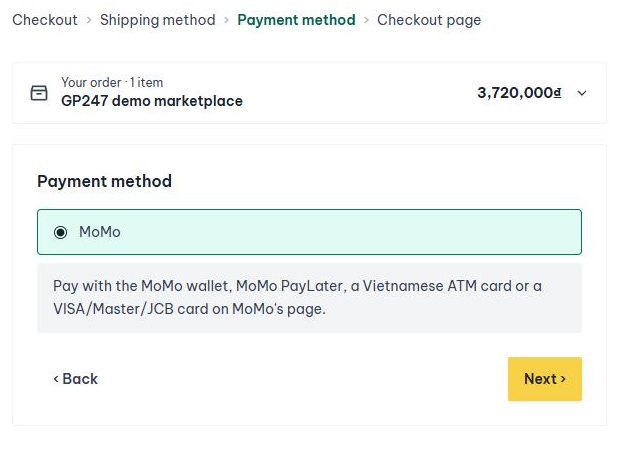
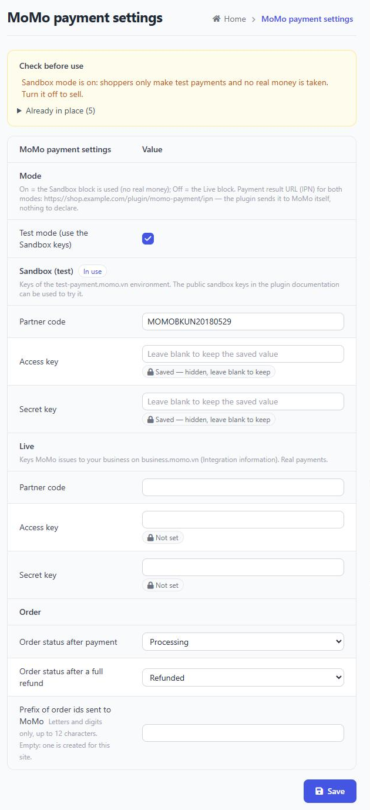

# MomoPayment Plugin

> 🌐 **Language:** [🇻🇳 Tiếng Việt](./readme_vi.md) · 🇬🇧 English (current) · [🇯🇵 日本語](./readme_ja.md)

Accept payments through **MoMo** in an S-Cart store: the MoMo wallet, MoMo PayLater, Vietnamese ATM cards and
VISA/Master/JCB cards. Shoppers pay on MoMo's page and come back to the store — card details never pass through your
website.

---

## Overview

| | |
| --- | --- |
| **Plugin** | MomoPayment |
| **Version** | 1.0.0 |
| **Developer** | GP247 |
| **License** | Free · open source, [MIT](./LICENSE) |
| **Requires** | GP247 Core **3.15+** · package `gp247/shop` · an active **VND** currency |
| **Does not need** | New Composer packages, cron, queue |

## Features

- One MoMo payment page for every method: wallet, PayLater, ATM card, international card.
- Money is recorded on the order **exactly once**, even when the shopper closes the browser before coming back (MoMo
  reports the result to the site — IPN — with a checked signature) or MoMo sends the notification several times.
- The return page asks MoMo again and never trusts what the return address says.
- A failed or cancelled payment cancels the order and returns its stock.
- **Payment links** (the shop's payment requests) paid through MoMo, and **refunds** (full or partial) through MoMo from
  the admin screens — including money a shopper paid at checkout.
- One MoMo account per store; keys are encrypted in the database and never shown again.
- A **Check before use** box on the settings screen: what still stops shoppers from paying with MoMo, with where to fix it.



## Installation

1. Copy the `MomoPayment` folder to `app/GP247/Plugins/` on the website (or upload the ZIP file at
   **Admin → Extensions / Plugins → Import**).
2. Go to **Admin → Extensions / Plugins**, find **MoMo** and click **Install**.

The plugin is enabled after installation, but it can only take money once you enter your MoMo keys (below).

## Configuration

Go to **Admin → Payment → MoMo**. The screen has four blocks:

| Block | Content |
| --- | --- |
| **Mode** | On = the Sandbox block is used (no real money); Off = the Live block. |
| **Sandbox** | Partner code, Access key, Secret key of the `test-payment.momo.vn` test environment. |
| **Live** | Partner code, Access key, Secret key MoMo issues to your business. |
| **Order** | Order status after payment / after a full refund; prefix of the order ids sent to MoMo (leaving it empty is fine). |

There is no result URL (IPN) to declare at MoMo: the plugin sends it with every payment. On a site with several stores,
pick the store at the top of the screen to enter its own keys; a store without keys uses the shared ones.



## Try it on the Sandbox

MoMo publishes a shared set of sandbox keys (in MoMo's official sample code on GitHub, `momo-wallet/payment`). Turn on
**Test mode** and paste them into the **Sandbox** block:

```
Partner code: MOMOBKUN20180529
Access key:   klm05TvNBzhg7h7j
Secret key:   at67qH6mk8w5Y1nAyMoYKMWACiEi2bsa
```

Place an order in VND and choose MoMo. On MoMo's page, pick an ATM or international card and use the test cards listed
under *Test Instructions* in MoMo's documentation (developers.momo.vn); to pay with the wallet, install the **MoMo
Test** app as described on the same page. No real money is taken.

These keys are shared by everyone, so the plugin adds a prefix of its own to every order id to avoid clashing with other
sites. A site running on a personal machine (localhost, `.test`…) does not receive the IPN; money is still recorded
when the shopper comes back to the store.

## Going live

1. Register a business account at **business.momo.vn** (for companies and household businesses), complete the
   verification and ask MoMo for the production integration details.
2. Paste the Partner code, Access key and Secret key into the **Live** block, then turn **Test mode** off.
3. The website must run on a public HTTPS domain so MoMo can send payment results back.

## Refunds

Refund through the shop's admin screens (the order or a payment request) so the refund is written to the order
automatically. A refund made on the MoMo Business portal is **not** reported to the website — record it on the order
screen by hand.

## Notes

- **Currency**: MoMo only accepts **VND**. An order in another currency cannot open MoMo; the shopper is asked to choose
  another method.
- If MoMo collects a different amount from the order total (rare), the amount MoMo took is recorded with a note and the
  order status is left for you to check.
- Uninstalling the plugin only removes its settings; payments and refunds already recorded on orders stay.

## MoMo official sources used to design the plugin

Version 1.0.0 was designed on exactly the official sources below. When MoMo changes its API, compare the new version of
these sources with the version recorded in the table to see what the plugin needs to update.

| Official source | Version / date | What the plugin relies on it for |
| --- | --- | --- |
| [Official sample code `momo-wallet/payment`](https://github.com/momo-wallet/payment) — files `php/config.json`, `php/PayMoMo/init_payment.php`, `ipn_momo.php`, `result.php`, `query_transaction.php` | Version 1.0.2 · commit [`d4746c5`](https://github.com/momo-wallet/payment/commit/d4746c5d1cc21d4efc96b3ad24cd0e19244c1dbd) (2022-07-28); folder `php/PayMoMo` last changed 2022-07-22 | Field order of the HMAC-SHA256 signatures for create payment, the returned result / IPN and query; the public Sandbox keys |
| MoMo payment API on the Sandbox `test-payment.momo.vn`: `/v2/gateway/api/create`, `/v2/gateway/api/query`, `/v2/gateway/api/refund` | API v2 · checked with test transactions on 2026-11-20 | Confirming that the create, query and refund signatures are accepted by MoMo (a wrong signature returns `11007 Invalid signature`) |

The developers.momo.vn documentation portal (v3) was not used as a basis for version 1.0.0; the next update should also be checked against it.

## Version history

- **1.0.0** — First release: MoMo payment page (wallet, PayLater, ATM, international cards), signed IPN, payment links and
  refunds through MoMo, per-store settings, encrypted keys, check-before-use box.
