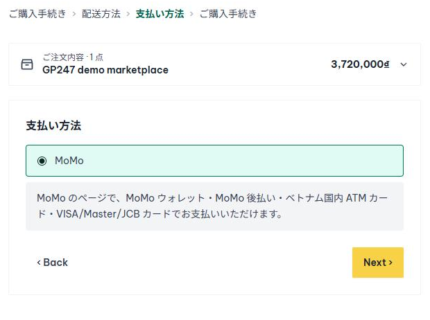
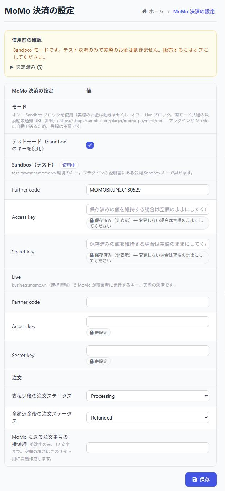

# MomoPayment プラグイン

> 🌐 **言語:** [🇻🇳 Tiếng Việt](./readme_vi.md) · [🇬🇧 English](./readme.md) · 🇯🇵 日本語（現在）

GP247/Shop のストアで **MoMo** による支払いを受け付けます：MoMo ウォレット、MoMo 後払い、ベトナム国内 ATM カード、
VISA/Master/JCB カード。購入者は MoMo のページで支払ってストアに戻ります。カード情報があなたのサイトを通ることはありません。

---

## 概要

| | |
| --- | --- |
| **プラグイン** | MomoPayment |
| **バージョン** | 1.0.0 |
| **開発** | GP247 |
| **ライセンス** | 無料 · オープンソース（[MIT](./LICENSE)） |
| **要件** | GP247 Core **3.15+** · パッケージ `gp247/shop` · 有効な通貨 **VND** |
| **不要** | 追加の Composer パッケージ、cron、キュー |

## 機能

- すべての支払い方法を 1 つの MoMo ページで：ウォレット、後払い、ATM カード、国際カード。
- 入金は注文に **ちょうど 1 回** 記録されます。購入者が戻る前にブラウザを閉じても（MoMo がサイトに結果を通知 — IPN —
  し、署名を検証）、MoMo が通知を複数回送っても同じです。
- 戻りページは MoMo に改めて問い合わせ、戻り先アドレスの内容は信用しません。
- 支払い失敗・キャンセル時は注文をキャンセルし、在庫を戻します。
- **支払いリンク**（ショップの支払い依頼）を MoMo で支払え、管理画面から MoMo 経由で **返金**（全額・一部）できます。
  チェックアウト時に支払われた金額も対象です。
- ストアごとに MoMo アカウントを設定可能。キーはデータベースで暗号化され、再表示されません。
- 設定画面の **利用前チェック**：MoMo で支払えない原因と修正場所を表示します。



## インストール

1. `MomoPayment` フォルダをサイトの `app/GP247/Plugins/` にコピーします（または
   **管理画面 → Extensions / Plugins → Import** で ZIP をアップロード）。
2. **管理画面 → Extensions / Plugins** で **MoMo** を探し、**Install** をクリックします。

インストール後は有効になりますが、入金を受けるには MoMo のキーを入力する必要があります（下記）。

## 設定

**管理画面 → Payment → MoMo** を開きます。画面は 4 つのブロックです：

| ブロック | 内容 |
| --- | --- |
| **モード** | オン = Sandbox ブロックを使用（実際のお金は動きません）、オフ = Live ブロック。 |
| **Sandbox** | テスト環境 `test-payment.momo.vn` の Partner code、Access key、Secret key。 |
| **Live** | MoMo が事業者に発行する Partner code、Access key、Secret key。 |
| **注文** | 支払い後 / 全額返金後の注文ステータス、MoMo に送る注文番号の接頭辞（空欄で問題ありません）。 |

MoMo 側に結果通知 URL（IPN）を登録する必要はありません。プラグインが毎回の支払いで送ります。複数ストアのサイトでは、
画面上部でストアを選んで個別のキーを入力します。キーを入力しないストアは共通のキーを使います。



## Sandbox で試す

MoMo は共用の Sandbox キーを公開しています（GitHub の MoMo 公式サンプル `momo-wallet/payment`）。**テストモード** を
オンにして **Sandbox** ブロックに貼り付けます：

```
Partner code: MOMOBKUN20180529
Access key:   klm05TvNBzhg7h7j
Secret key:   at67qH6mk8w5Y1nAyMoYKMWACiEi2bsa
```

VND で注文し、MoMo を選びます。MoMo のページで ATM カードまたは国際カードを選び、MoMo のドキュメント
（developers.momo.vn）の *Test Instructions* にあるテストカードを使います。ウォレットで支払う場合は、同じページの案内に
従って **MoMo Test** アプリをインストールします。実際のお金は動きません。

このキーは全員で共用のため、プラグインは注文番号にサイト固有の接頭辞を付け、他サイトとの重複を防ぎます。個人の PC
（localhost、`.test` など）で動くサイトには IPN が届きませんが、購入者がストアに戻った時点で入金は記録されます。

## 本番運用（Live）

1. **business.momo.vn** で事業者アカウント（法人・個人事業主向け）を登録し、確認を完了して本番環境の連携情報を
   MoMo に申請します。
2. Partner code、Access key、Secret key を **Live** ブロックに貼り付け、**テストモード** をオフにします。
3. MoMo が支払い結果を送れるよう、サイトは HTTPS の公開ドメインで動かしてください。

## 返金

ショップの管理画面（注文または支払い依頼）から返金すると、返金が注文に自動で記録されます。MoMo Business ポータルで
返金した場合はサイトに通知 **されません**。注文画面で手動で記録してください。

## 注意事項

- **通貨**：MoMo は **VND** のみ対応です。他の通貨の注文では MoMo を開けず、購入者に別の方法を選ぶよう案内します。
- MoMo の受領額が注文合計と異なる場合（まれ）、MoMo の受領額をメモ付きで記録し、注文ステータスは確認のためそのままにします。
- プラグインをアンインストールしても削除されるのは設定のみです。注文に記録済みの入金・返金は残ります。

## プラグイン設計に使用した MoMo 公式資料

バージョン 1.0.0 は、以下の公式資料のみに基づいて設計されています。MoMo が API を変更した場合は、これらの資料の新しい
バージョンを表に記載したバージョンと比較し、プラグインに必要な更新を確認してください。

| 公式資料 | バージョン / 日付 | プラグインでの用途 |
| --- | --- | --- |
| [公式サンプルコード `momo-wallet/payment`](https://github.com/momo-wallet/payment) — ファイル `php/config.json`、`php/PayMoMo/init_payment.php`、`ipn_momo.php`、`result.php`、`query_transaction.php` | Version 1.0.2 · コミット [`d4746c5`](https://github.com/momo-wallet/payment/commit/d4746c5d1cc21d4efc96b3ad24cd0e19244c1dbd)（2022-07-28）、フォルダ `php/PayMoMo` の最終更新 2022-07-22 | 支払い作成・結果の返却 / IPN・照会の HMAC-SHA256 署名のフィールド順、公開 Sandbox キー |
| Sandbox `test-payment.momo.vn` の MoMo 決済 API：`/v2/gateway/api/create`、`/v2/gateway/api/query`、`/v2/gateway/api/refund` | API v2 · 2026-11-20 にテスト取引で確認 | 支払い作成・照会・返金の署名が MoMo に受け入れられることの確認（署名が誤っていると `11007 Invalid signature` が返る） |

ドキュメントポータル developers.momo.vn（v3）はバージョン 1.0.0 の設計根拠には使用していません。次回の更新時に併せて照合してください。

## バージョン履歴

- **1.0.0** — 初回リリース：MoMo 支払いページ（ウォレット、後払い、ATM、国際カード）、署名付き IPN、MoMo 経由の
  支払いリンクと返金、ストア別設定、キーの暗号化、利用前チェック。
