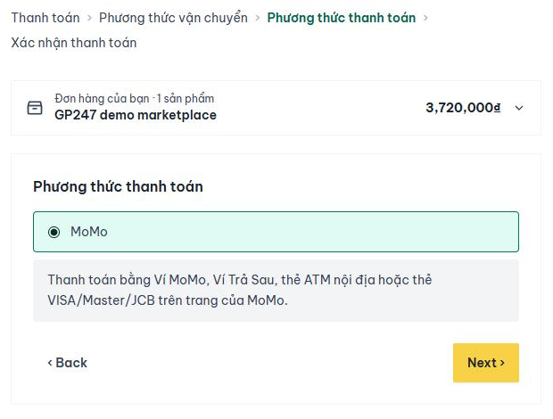
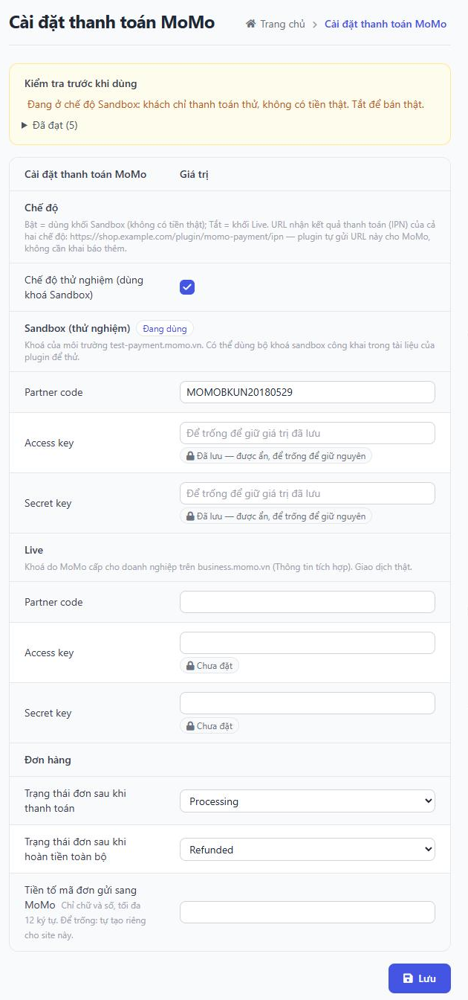

# Plugin MomoPayment

> 🌐 **Ngôn ngữ:** 🇻🇳 Tiếng Việt (hiện tại) · [🇬🇧 English](./readme.md) · [🇯🇵 日本語](./readme_ja.md)

Nhận thanh toán qua **MoMo** cho cửa hàng GP247/Shop: Ví MoMo, Ví Trả Sau, thẻ ATM nội địa và thẻ VISA/Master/JCB.
Khách thanh toán trên trang của MoMo rồi quay về cửa hàng — thông tin thẻ không đi qua website của bạn.

---

## Tổng quan

| | |
| --- | --- |
| **Plugin** | MomoPayment |
| **Phiên bản** | 1.0.0 |
| **Nhà phát triển** | GP247 |
| **Giấy phép** | Miễn phí · mã nguồn mở, [MIT](./LICENSE) |
| **Yêu cầu** | GP247 Core **3.15+** · package `gp247/shop` · tiền tệ **VND** đang bật |
| **Không cần** | Composer package mới, cron, queue |

## Tính năng

- Một trang thanh toán MoMo cho mọi phương thức: Ví MoMo, Ví Trả Sau, thẻ ATM, thẻ quốc tế.
- Tiền ghi vào đơn **đúng một lần**, kể cả khi khách đóng trình duyệt trước khi quay về (MoMo báo kết quả về site — IPN —
  có kiểm chữ ký) hoặc MoMo gửi thông báo nhiều lần.
- Trang quay về tự hỏi lại MoMo, không tin dữ liệu trên địa chỉ trả về.
- Thanh toán thất bại hoặc khách huỷ: đơn được huỷ và hàng trả về kho.
- **Link thanh toán** (Yêu cầu thanh toán của shop) trả qua MoMo, và **hoàn tiền** (toàn phần hoặc một phần) qua MoMo
  ngay trên màn quản trị — kể cả khoản khách đã trả khi đặt hàng.
- Mỗi cửa hàng một tài khoản MoMo; khoá được mã hoá trong cơ sở dữ liệu và không bao giờ hiện lại.
- Khung **Kiểm tra trước khi dùng** trên màn cấu hình: những gì còn khiến khách chưa trả được bằng MoMo, kèm chỗ sửa.



## Cài đặt

1. Chép thư mục `MomoPayment` vào `app/GP247/Plugins/` trên website (hoặc tải file ZIP lên ở
   **Admin → Extensions / Plugins → Import**).
2. Vào **Admin → Extensions / Plugins**, tìm **MoMo** và bấm **Install**.

Plugin được bật sau khi cài, nhưng chỉ nhận tiền được sau khi bạn nhập khoá MoMo (mục dưới).

## Cấu hình

Vào **Admin → Payment → MoMo**. Màn chia bốn khối:

| Khối | Nội dung |
| --- | --- |
| **Chế độ** | Bật = dùng khối Sandbox (không có tiền thật); Tắt = khối Live. |
| **Sandbox** | Partner code, Access key, Secret key của môi trường thử `test-payment.momo.vn`. |
| **Live** | Partner code, Access key, Secret key MoMo cấp cho doanh nghiệp của bạn. |
| **Đơn hàng** | Trạng thái đơn sau khi thanh toán / sau khi hoàn tiền toàn bộ; tiền tố mã đơn gửi sang MoMo (để trống là được). |

Không cần khai báo URL nhận kết quả (IPN) ở MoMo: plugin tự gửi URL này trong mỗi giao dịch. Site có nhiều cửa hàng
thì chọn cửa hàng ở đầu màn để nhập khoá riêng; cửa hàng không nhập sẽ dùng khoá chung.



## Thử trên Sandbox

MoMo công bố sẵn một bộ khoá sandbox dùng chung (trong mã mẫu chính thức của MoMo trên GitHub, `momo-wallet/payment`).
Bật **Chế độ thử nghiệm** và dán vào khối **Sandbox**:

```
Partner code: MOMOBKUN20180529
Access key:   klm05TvNBzhg7h7j
Secret key:   at67qH6mk8w5Y1nAyMoYKMWACiEi2bsa
```

Đặt một đơn bằng VND, chọn MoMo. Trên trang MoMo, chọn thẻ ATM hoặc thẻ quốc tế và dùng thẻ thử trong mục
*Test Instructions* của tài liệu MoMo (developers.momo.vn); muốn trả bằng ví thì cài ứng dụng **MoMo Test** theo hướng
dẫn ở cùng trang. Không có tiền thật nào bị trừ.

Bộ khoá này dùng chung cho mọi người nên plugin tự thêm tiền tố riêng của site vào mã đơn, tránh trùng với site khác.
Site chạy ở máy cá nhân (localhost, `.test`…) không nhận được IPN; tiền vẫn được ghi khi khách quay về cửa hàng.

## Chạy thật (Live)

1. Đăng ký tài khoản doanh nghiệp tại **business.momo.vn** (dành cho doanh nghiệp và hộ kinh doanh), hoàn tất xác minh
   và yêu cầu MoMo cấp thông tin tích hợp môi trường thật.
2. Dán Partner code, Access key, Secret key vào khối **Live**, rồi tắt **Chế độ thử nghiệm**.
3. Website phải chạy trên tên miền công khai có HTTPS để MoMo gửi được kết quả thanh toán về.

## Hoàn tiền

Hoàn tiền qua màn quản trị của shop (đơn hàng hoặc Yêu cầu thanh toán) để tiền hoàn được ghi vào đơn tự động. Nếu bạn
hoàn trên cổng MoMo Business, MoMo **không** báo về website — hãy ghi khoản hoàn đó trên màn đơn hàng bằng tay.

## Lưu ý

- **Tiền tệ**: MoMo chỉ nhận **VND**. Đơn bằng tiền tệ khác sẽ không mở được MoMo; khách được mời chọn cách khác.
- Số tiền MoMo thu khác tổng đơn (hiếm) được ghi đúng số MoMo thu kèm ghi chú, trạng thái đơn giữ nguyên để bạn kiểm tra.
- Gỡ plugin chỉ xoá cấu hình của plugin; các khoản thu/hoàn đã ghi vào đơn vẫn giữ nguyên.

## Tài liệu chính thức của MoMo dùng để thiết kế plugin

Bản 1.0.0 được thiết kế dựa trên đúng các nguồn chính thức dưới đây. Khi MoMo thay đổi API, hãy so phiên bản mới của các
nguồn này với phiên bản ghi trong bảng để biết plugin cần cập nhật gì.

| Nguồn chính thức | Phiên bản / ngày | Plugin dựa vào để |
| --- | --- | --- |
| [Mã mẫu chính thức `momo-wallet/payment`](https://github.com/momo-wallet/payment) — các file `php/config.json`, `php/PayMoMo/init_payment.php`, `ipn_momo.php`, `result.php`, `query_transaction.php` | Version 1.0.2 · commit [`d4746c5`](https://github.com/momo-wallet/payment/commit/d4746c5d1cc21d4efc96b3ad24cd0e19244c1dbd) (28/07/2022); thư mục `php/PayMoMo` sửa lần cuối 22/07/2022 | Thứ tự trường khi ký HMAC-SHA256 cho tạo thanh toán, kết quả trả về / IPN và tra cứu; bộ khoá Sandbox công khai |
| API thanh toán MoMo trên Sandbox `test-payment.momo.vn`: `/v2/gateway/api/create`, `/v2/gateway/api/query`, `/v2/gateway/api/refund` | API v2 · đối chiếu bằng giao dịch thử ngày 20/11/2026 | Xác nhận chữ ký tạo thanh toán, tra cứu và hoàn tiền được MoMo chấp nhận (ký sai thì MoMo trả `11007 Invalid signature`) |

Cổng tài liệu developers.momo.vn (bản v3) không được dùng làm căn cứ cho bản 1.0.0; lần cập nhật sau nên đối chiếu thêm với nó.

## Lịch sử phiên bản

- **1.0.0** — Phát hành đầu tiên: trang thanh toán MoMo (ví, ví trả sau, ATM, thẻ quốc tế), IPN có chữ ký, link thanh
  toán và hoàn tiền qua MoMo, cấu hình theo cửa hàng, mã hoá khoá, khung kiểm tra trước khi dùng.
